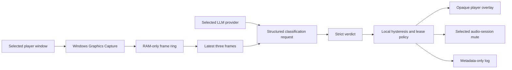

# LLM AdShield

LLM AdShield is an experimental Windows 11 desktop application that watches a player window, asks a vision-capable LLM whether the current segment is programming or advertising, and temporarily covers and mutes confirmed commercials.

It is designed for live TV and IPTV playback where advertisements are already embedded in the video stream and therefore cannot be removed by a browser content blocker. The application observes the selected window; it does not edit, proxy, decrypt, or modify the stream.

> [!IMPORTANT]
> LLM classification is fallible. Begin in **Shadow mode** for at least 30–60 minutes and review its behavior before enabling automatic muting. Never rely on this application to preserve emergency or public-safety information.

## Project status

LLM AdShield is a Windows-only proof of concept, not a finished consumer product.

| Item | Current status |
| --- | --- |
| Supported OS | Windows 11, x64 |
| UI | WPF on .NET 10 |
| Capture | User-selected window through Windows Graphics Capture |
| Audio action | User-selected Windows audio session through Core Audio |
| LLM providers | OpenAI or Anthropic, explicitly selected by the user |
| Distribution | Self-contained unsigned Windows build |
| Tests | 53 automated desktop tests |
| Audio transcription | Design only; not implemented or enabled |

## What it does

- Lists visible top-level windows and lets the user explicitly choose the player.
- Lists active application audio sessions and lets the user explicitly choose the one that may be muted.
- Samples the selected window at two frames per second.
- Resizes frames in memory to a maximum of 640×360.
- Maintains a bounded ten-second RAM-only frame buffer.
- Sends the latest three ordered frames to either OpenAI or Anthropic for each decision.
- Applies a local state machine so one inconsistent frame does not immediately uncover an advertisement.
- Displays an opaque, click-through neutral cover over the player during confirmed ads.
- Mutes only the selected audio session and preserves its original mute state.
- Restores audio on normal stop, emergency unmute, source loss, budget exhaustion, provider failure, shutdown, and recovery after an interrupted run.
- Writes metadata-only JSONL logs for debugging and shadow-mode review.

## What it deliberately does not do

- It does not bypass DRM, protected surfaces, secure video paths, provider controls, or access restrictions.
- It does not intercept or rewrite an IPTV playlist or media stream.
- It does not save screenshots, record video, upload audio, or capture the microphone.
- It does not identify people or brands.
- It does not silently switch LLM providers.
- It does not mute Windows master volume.
- It cannot predict an ad before visual evidence appears, so the opening two to five seconds may be visible or audible.

Protected or black capture is treated as unsupported and fails open.

## How it works



The cloud model supplies evidence; local code owns the decision to block or release. Unknown, stale, refused, failed, and over-budget responses cannot initiate muting.

### Classification labels

The provider must return a strict structured verdict containing:

- `current_label`: `program`, `commercial`, `promo_or_sponsor`, `public_safety`, or `unknown`
- `transition`: `none`, `ad_start`, `ad_end`, or `unclear`
- `confidence`: `low`, `medium`, or `high`
- a fixed-enum evidence array
- `needs_more_context`: boolean

Paid commercials, shopping or infomercial segments, sponsor spots, trailers, and obvious network/service promos count as advertising. Product placement, persistent channel logos, stadium signage, editorial product discussion, and fictional ads inside a program remain program content unless the broadcast has clearly entered a commercial break.

### Blocking and release policy

- One high-confidence ad verdict can begin blocking.
- Two medium-confidence ad verdicts within four seconds can also begin blocking.
- A confirmed block has a minimum 20-second hold.
- Further ad verdicts renew a ten-second mute lease.
- After the hold, a reported `ad_end` still requires consistent medium/high program evidence.
- Without `ad_end`, five consecutive usable program verdicts are required.
- Low-confidence program guesses do not release a confirmed block.
- `public_safety`, emergency unmute, source loss, and hard-budget exhaustion fail open.
- Results older than three seconds are discarded.
- Only one request may be in flight; missed intervals are dropped rather than queued.

These defaults are intentionally conservative because briefly covering a program is preferable to repeatedly flashing an ad, but the application can still make mistakes.

## Requirements

To run the published build:

- Windows 11 on an x64 PC
- a visible, non-minimized player or browser window
- an active Windows audio session for that player
- internet access
- either an OpenAI API key or an Anthropic API key with access to the configured model

To build from source, install the .NET 10 SDK selected by [`global.json`](global.json). Visual Studio is optional.

ChatGPT Plus/Pro and Claude Pro/Max subscriptions do not provide API credits. API usage is separately billed by the selected provider.

## Quick start with the published build

1. Download the Windows ZIP and its SHA-256 checksum from the release.
2. Verify the checksum before extracting it.
3. Extract the complete ZIP to a writable folder.
4. Run `LLMAdShield.exe`.
5. If Windows SmartScreen appears, verify that the checksum matches the release before choosing to run the unsigned application.
6. Start playback in a dedicated player window.
7. In LLM AdShield, select that player window and click **Refresh** if necessary.
8. Select the matching active audio session. Start audible playback before refreshing the audio list.
9. Choose OpenAI or Anthropic in **Provider settings**, paste the corresponding API key, and select **Save key**.
10. Leave **Shadow mode** selected and start detection.
11. Observe ordinary programming and several ad breaks for at least 30–60 minutes.
12. Enable **Automatic mute** only after the shadow results are acceptable.

Closing the main window hides it in the notification area. Use the tray menu's **Exit** command to close the process completely.

## API-key configuration

The preferred method is the in-app **Provider settings** panel. A saved key is encrypted with Windows DPAPI for the current Windows account and stored under:

```text
%LOCALAPPDATA%\LLMAdShield\secrets
```

The plaintext key is not written to settings or logs. **Remove saved key** deletes the selected provider's encrypted credential.

For temporary development use, set a process-scoped environment variable in the same PowerShell window used to launch the application:

```powershell
$env:OPENAI_API_KEY = "your-openai-api-key"
# or
$env:ANTHROPIC_API_KEY = "your-anthropic-api-key"

& .\LLMAdShield.exe
```

An in-app saved key takes precedence over the matching environment variable. Saving a key does not make a paid validation request; the first request occurs after detection starts.

Never commit a real key to this repository, a `.env` file, a screenshot, an issue, or a diagnostic archive.

## Controls

| Control | Behavior |
| --- | --- |
| **Shadow mode** | Classifies and logs decisions without displaying the cover or changing audio. |
| **Automatic mute** | Allows confirmed ad decisions to cover the player and mute its selected audio session. |
| **Pause** | Stops capture/classification and restores the original audio state. |
| **Emergency unmute** | Immediately restores audio and returns to non-automatic behavior. |
| `Ctrl+Alt+A` | Adds a metadata-only manual annotation for an ad/promo. |
| `Ctrl+Alt+P` | Adds a metadata-only manual annotation for programming. |
| `Ctrl+Alt+U` | Emergency unmute from anywhere in Windows. |

Manual annotations do not save the current frame.

## Privacy and network behavior

Each classification request contains up to three resized images from the selected window. No audio is sent. Frames are Base64-encoded only in the in-memory HTTPS request body and are not written to disk by the application.

The selected provider receives the request:

| Provider | Endpoint |
| --- | --- |
| OpenAI | `https://api.openai.com/v1/responses` |
| Anthropic | `https://api.anthropic.com/v1/messages` |

OpenAI requests set `store: false`. Provider retention, abuse-monitoring, regional, and organization-level controls still apply; consult the current provider documentation before using the application with sensitive screen content.

Metadata logs are written to:

```text
%LOCALAPPDATA%\LLMAdShield\logs\session-YYYYMMDD-HHMMSS.jsonl
```

Logs may contain timestamps, verdict enums, transitions, confidence, latency, token counts, estimated cost, decisions, error codes, and manual annotations. They do not contain frames, Base64 data, API keys, raw provider responses, prompts, audio, transcripts, IPTV credentials, or playlists.

See [`docs/PRIVACY.md`](docs/PRIVACY.md) for the complete data-flow and deletion guidance.

## Audio restoration and recovery

Before changing any selected audio session, LLM AdShield writes its original mute state to:

```text
%LOCALAPPDATA%\LLMAdShield\audio-mute-recovery.json
```

The record is written before mutation. Normal release restores the exact saved state and removes the record. On the next launch, the application checks for an interrupted lease and retries restoration before allowing another run.

If audio ever remains muted:

1. Launch LLM AdShield again and allow startup recovery to run.
2. Use **Emergency unmute**.
3. If the original process/session no longer exists, restore the player manually in Windows Volume Mixer.
4. Do not delete the recovery record until the relevant audio session is normal.

## Cost controls

Provider calls consume the user's API credits. Each run begins with a fresh local estimate:

- warning at US$8
- hard stop at US$10
- no new request starts when its reserved maximum could cross the cap
- budget exhaustion removes the cover and restores audio

The displayed value is an estimate based on configured token prices. The provider's billing dashboard is authoritative. Model names and prices change, so review [`AppSettings.cs`](src/LLMAdShield.Windows/Configuration/AppSettings.cs) before publishing a release.

## Build from source

From a PowerShell prompt at the repository root:

```powershell
dotnet restore .\LLMAdShield.slnx
dotnet build .\LLMAdShield.slnx --configuration Release --no-restore
dotnet test .\LLMAdShield.slnx --configuration Release --no-build
```

Run the development build:

```powershell
dotnet run --project .\src\LLMAdShield.Windows\LLMAdShield.Windows.csproj
```

Publish a self-contained x64 build:

```powershell
dotnet publish .\src\LLMAdShield.Windows\LLMAdShield.Windows.csproj `
  --configuration Release `
  --runtime win-x64 `
  --self-contained true `
  --output .\artifacts\publish\win-x64
```

The executable will be `artifacts\publish\win-x64\LLMAdShield.exe`.

## Repository layout

```text
LLMAdShield/
├── src/
│   ├── LLMAdShield.Core/          detection policy, verdict schema, budgets, frame ownership
│   └── LLMAdShield.Windows/       WPF UI, capture, Core Audio, overlay, providers, logging
├── tests/
│   ├── LLMAdShield.Core.Tests/    pure state, schema, frame, budget, and log tests
│   └── LLMAdShield.Windows.Tests/ provider, audio, overlay, configuration, and coordinator tests
├── docs/                           architecture, privacy, release, and audio-assist design
└── .github/                        CI, dependency updates, issue forms, and PR template
```

The key internal boundaries are `ICaptureSource`, `IAdClassifier`, `IDetectionStateMachine`, `IAudioMuteLease`, and `IOverlayPresenter`. See [`docs/ARCHITECTURE.md`](docs/ARCHITECTURE.md).

## Testing

The test suite uses synthetic frames, fake HTTP handlers, and fake audio/capture boundaries. CI does not require API keys and does not make paid provider calls.

Current automated coverage includes:

- strict verdict serialization and invalid-output rejection
- ad confirmation, minimum hold, renewal, stale results, and program release
- public-safety and emergency fail-open behavior
- frame ownership and RAM-ring disposal
- budget reservations and hard-cap behavior
- OpenAI and Anthropic request/response contracts
- provider-key resolution and DPAPI store behavior
- Core Audio enumeration, mute recovery, identity matching, and rollback
- overlay exclusion and lifecycle behavior
- coordinator shutdown and failure injection

Real Windows integration testing should additionally cover resize, DPI scaling, minimizing, player exit, browser child processes, shared browser audio, protected/black capture, 429/5xx responses, network loss, forced interruption, and startup recovery.

## Troubleshooting

### The player window is missing

Keep the player visible and not minimized, then select **Refresh**. Some protected or elevated windows cannot be captured from a normal process.

### No audio session appears

Start audible playback first, wait a moment, and refresh the audio list. Browsers may share one audio session across multiple tabs or use helper processes. A dedicated player or separate browser profile is easier to target safely.

### Capture is black or classifications stop

Use windowed playback and restore the player from a minimized state. Protected video can intentionally return black frames. LLM AdShield will not bypass that protection.

### The provider returns errors

Confirm the selected provider, saved key or environment variable, API billing, model access, system clock, and internet connectivity. Rate limits, timeouts, malformed output, and provider failures fail open.

### SmartScreen warns about the executable

Public proof-of-concept builds are currently unsigned. Verify the release checksum and build provenance. Do not bypass a warning for an artifact whose hash you cannot verify.

### The wrong application was muted

Use `Ctrl+Alt+U` immediately. Pause detection, start playback in the intended player, refresh the audio sessions, and select the exact matching session. LLM AdShield never intentionally changes master volume.

## Known limitations

- Ad onset cannot be instantaneous because classification begins after the ad appears.
- Cloud latency and provider availability affect detection speed.
- Visual-only evidence may miss ad-like speech over ordinary footage.
- Browser windows and audio sessions can be shared across tabs or helper processes.
- Protected playback may be black or unavailable.
- Overlay placement depends on the selected window remaining identifiable.
- Estimated provider pricing can become outdated.
- No code-signing certificate or installer is currently provided.
- The acceptance goals are targets, not guarantees: at least 90% of ad seconds muted, median onset under three seconds, p95 onset under five seconds, p95 restoration under two seconds, no public-safety mute, and no more than one false-mute event per viewing hour.

## Responsible use

Use LLM AdShield only on devices, accounts, playback services, and content you are authorized to access. Do not submit changes that bypass DRM, extract credentials, intercept protected streams, weaken secure-surface behavior, or collect broader screen/audio data without explicit consent.

Security issues should be reported privately as described in [`SECURITY.md`](SECURITY.md). Contributions should follow [`CONTRIBUTING.md`](CONTRIBUTING.md) and the [`CODE_OF_CONDUCT.md`](CODE_OF_CONDUCT.md).

Release history is recorded in [`CHANGELOG.md`](CHANGELOG.md).

## Roadmap

Potential future work includes signed releases, a settings UI for model IDs and budget limits, reproducible release automation, shadow-mode review tools, and optional process-scoped local transcription. Audio assist remains design-only and must meet the privacy requirements in [`docs/AUDIO_ASSIST.md`](docs/AUDIO_ASSIST.md) before implementation.

## License

LLM AdShield is released under the [MIT License](LICENSE).
