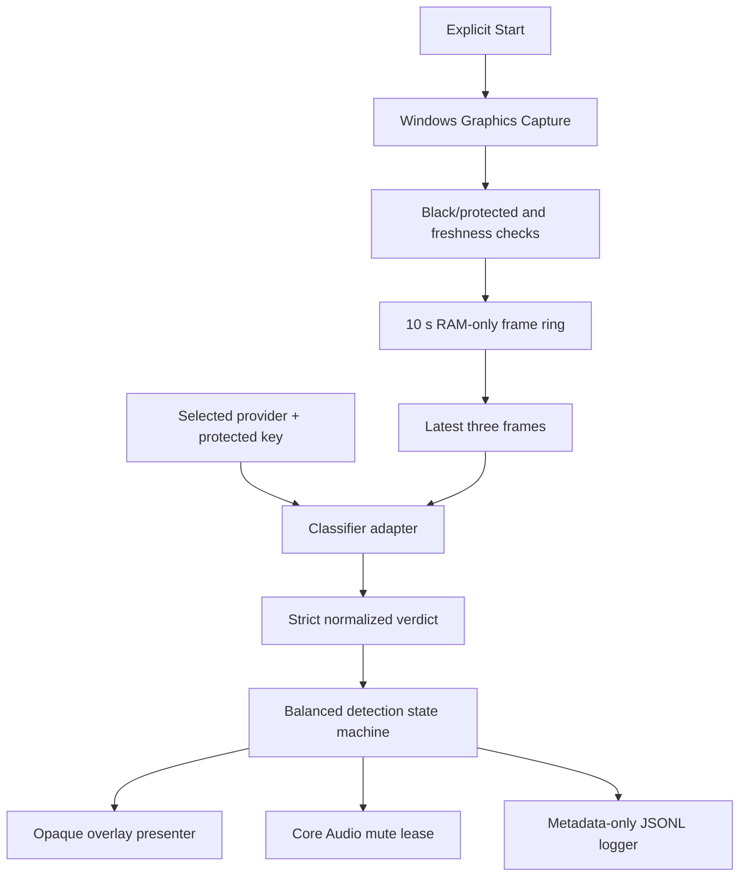

# Architecture

LLM AdShield is a Windows-only WPF application split between platform-neutral policy code and Windows integration code. It observes user-authorized playback, obtains a narrow structured verdict from the selected provider, and applies a short reversible overlay/audio lease. It does not modify or decrypt the media stream.

## Repository layout

```text
src/
  LLMAdShield.Core/          verdict schema, frame ownership, policy, budgets, log records
  LLMAdShield.Windows/       WPF, capture, audio, overlay, providers, DPAPI, telemetry
tests/
  LLMAdShield.Core.Tests/    deterministic policy and ownership tests
  LLMAdShield.Windows.Tests/ Windows boundaries and provider-contract tests
```

## Runtime flow



One `DetectionCoordinator` owns a run. It serializes lifecycle transitions, keeps at most one classification request active, drops missed intervals instead of creating a backlog, and owns cleanup of capture, audio, overlay, classifiers, and telemetry.

## Stable boundaries

| Boundary | Responsibility |
| --- | --- |
| `ICaptureSource` | Produces timestamped owned frames and reports source loss. |
| `IAdClassifier` | Converts a three-frame window into a normalized `ClassificationResult`. |
| `IDetectionStateMachine` | Owns confirmation, holds, renewals, release, staleness, and fail-open policy. |
| `IAudioMuteLease` | Journals and reversibly changes only the selected audio session. |
| `IOverlayPresenter` | Tracks the selected window and presents/removes the neutral cover. |

Provider-specific JSON and Windows COM/WinRT types must not leak into `LLMAdShield.Core`.

## Capture ownership

`WindowsGraphicsCaptureSource` captures only the selected top-level window, samples at two frames per second, resizes in memory to at most 640×360, and encodes JPEG frames in memory. `FrameRingBuffer` owns and disposes the encoded byte buffers. A `FrameWindow` receives owned clones and disposes them after the request completes.

Capture drains to the newest frame so slow provider responses never create a stale-frame queue. Consecutive likely-black frames mark the source unsupported and stop uploads.

## Provider isolation

OpenAI and Anthropic implement the same `IAdClassifier` contract. A run selects exactly one provider; there is no silent fallback because fallback could disclose frames to a service the user did not choose.

Adapters must:

- submit the same ordered frames and policy definitions;
- request or validate the strict shared verdict schema;
- use bounded timeouts and output tokens;
- expose usage and estimated cost without logging bodies;
- convert refusals, malformed responses, HTTP errors, timeouts, and incomplete responses into failure outcomes;
- avoid retries that could create duplicate spend or a request backlog.

## Detection invariants

- Only `commercial` or `promo_or_sponsor` can begin or renew blocking.
- `unknown`, low-confidence, stale, refused, failed, or over-budget results cannot begin blocking.
- One high-confidence ad verdict or two medium-confidence verdicts within four seconds may acquire the lease.
- A new lease has a 20-second minimum hold; ad evidence renews a ten-second expiry.
- Program release requires consistent medium/high evidence after the hold.
- `public_safety` is release-only and fails open immediately.
- Source loss, emergency unmute, user stop, budget exhaustion, and coordinator failure restore state.

## Audio transaction and recovery

The audio layer enumerates Core Audio sessions and operates on an explicitly selected session identity. Before mutation it writes a versioned recovery journal containing the original mute state. Journal ownership is protected with an exclusive lock so two LLM AdShield processes cannot control the same lease.

Cleanup is idempotent. If immediate restoration fails, the journal is retained and a later retry or next application launch attempts recovery. Missing or ambiguous sessions are never guessed.

## Overlay safety

The WPF overlay follows the selected window, is non-activating and click-through, and is excluded from Windows capture with `WDA_EXCLUDEFROMCAPTURE`. If the target identity changes, disappears, or the overlay fails, automation stops and audio restoration is attempted.

## Budgeting

The run budget reserves the configured maximum request cost before dispatch. This prevents concurrent timing from crossing the hard cap. Actual usage reconciles the reservation when a response arrives. Missing usage is charged conservatively at the reserved maximum.

## Telemetry

The logger accepts typed metadata records only. It never receives a frame, request body, Base64 payload, credential, prompt, transcript, or raw provider response. See [`PRIVACY.md`](PRIVACY.md).

## Test strategy

- Core tests cover verdict JSON, state transitions, leases, budgets, frame disposal, and metadata serialization.
- Windows tests use fake HTTP handlers and fake platform boundaries for provider, coordinator, DPAPI, Core Audio, and overlay behavior.
- CI never needs a provider key and never calls a paid endpoint.
- Manual release validation covers real capture, DPI/resize, browser process trees, audio restoration, protected frames, interruptions, and startup recovery.
