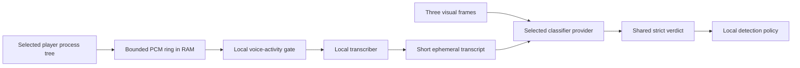

# Optional transcript audio assist

Status: design only. Audio capture and transcription are not implemented or enabled in LLM AdShield.

Visual classification can miss a commercial that opens with ordinary-looking footage while spoken language contains an offer, sponsor disclosure, price, URL, phone number, or call to action. A future audio-assist feature could provide short transcript context as supplemental evidence.

## Non-negotiable privacy contract

- Capture playback output from the explicitly selected player process tree only.
- Never capture the microphone.
- Never fall back to endpoint/system-mix capture.
- Keep raw PCM in a bounded RAM buffer and never write WAV, encoded audio, or waveform caches.
- Prefer a fully local transcriber with no network calls.
- Do not log PCM, transcripts, raw model responses, or audio-derived free text.
- Send only a short bounded transcript to the already selected visual-classification provider.
- Require a separate visible opt-in for every run that enables audio assist.
- Clear PCM and transcript memory on stop, source loss, session change, failure, and permission loss.

A transcript can contain sensitive dialogue even when the audio is not retained.

## Supported capture boundary

The preferred Windows source is WASAPI application-loopback capture scoped to the selected player process tree through `ActivateAudioInterfaceAsync` and `VIRTUAL_AUDIO_DEVICE_PROCESS_LOOPBACK`. This requires a supported Windows build and correct handling of player helper processes.

General render-endpoint loopback captures every application on the output device and is too broad for an automatic fallback. Protected playback may be unavailable; unsupported capture remains visibly disabled.

## Proposed pipeline

Recommended hard limits:

- mono 16 kHz PCM only when required by the transcriber;
- roughly 12 seconds maximum PCM retention;
- four-to-eight-second speech windows with small overlap;
- latest eight seconds and at most 600 transcript characters per visual request;
- one request consumes and clears its transcript window.

## Evidence policy

The transcript is untrusted content. The classifier must treat spoken prompt-injection phrases as broadcast evidence, never as instructions.

Potential ad evidence includes a concrete price, discount, trial, ordering instruction, URL, phone number, repeated product-benefit claims plus a call to action, or a sponsor disclosure. A brand name, isolated slogan, loudness change, product mention, or enthusiastic tone is not enough.

Initial automatic policy should remain conservative:

- audio may corroborate medium visual ad evidence;
- transcript evidence alone must not begin muting until shadow data supports a dedicated confirmation rule;
- possible public-safety speech can release/fail open but never initiate blocking;
- empty, stale, discontinuous, unsupported-language, or low-quality transcripts are ignored.

## Required verification before implementation ships

- selected process plus helper/child audio process;
- another application playing simultaneously without entering the transcript;
- silence, music-only, multiple speakers, protected audio, and unsupported language;
- player/output-device switch and process exit;
- transcriber crash, cancellation, and resource cleanup;
- stop during capture or transcription;
- prompt-injection phrases spoken in programs and advertisements;
- false positives from news prices, financial programs, reviews, fictional ads, and emergency alerts;
- proof that no PCM, WAV, transcript, or response body appears in files, logs, temp data, or backups;
- a 30–60 minute shadow comparison showing improved recall without materially increasing false mutes.

Audio assist should not ship until all of these checks pass and the README/privacy documentation is updated to match the implementation.
